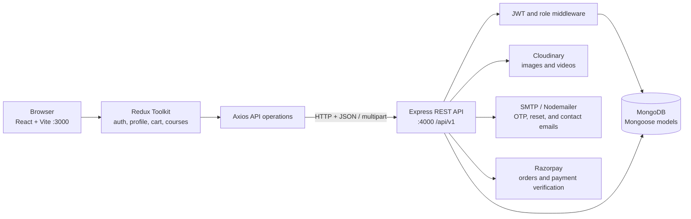
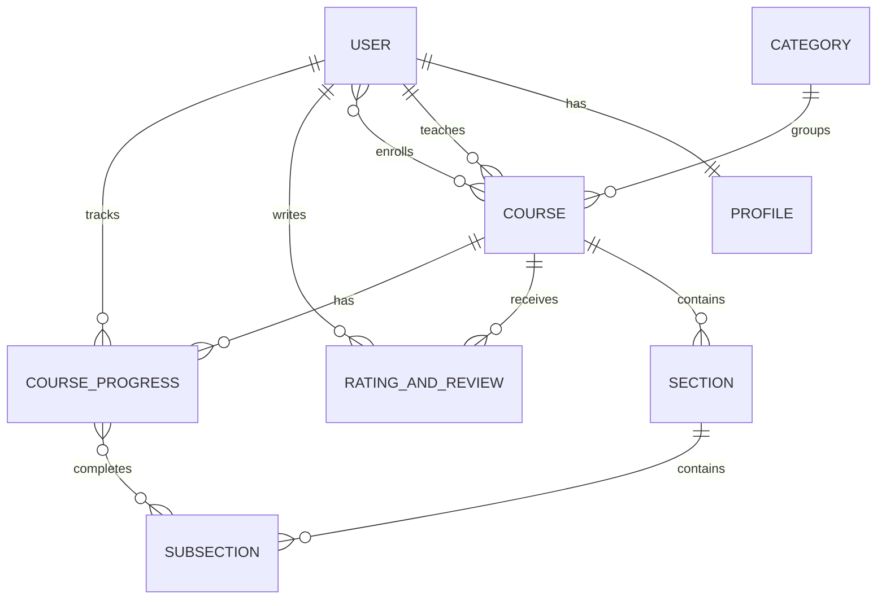

# StudyNotion

StudyNotion is a full-stack learning platform for discovering courses, enrolling in them, and studying video-based lessons. It also provides instructor tools for building and managing course content. The application is implemented as a React single-page frontend backed by an Express REST API and MongoDB.

> This README describes the application and its current API integrations. Third-party services such as MongoDB, Cloudinary, SMTP, and Razorpay must be configured for the related features to work.

## Table of Contents

- [Overview](#overview)
- [Features](#features)
- [Technology Stack](#technology-stack)
- [Architecture](#architecture)
- [Frontend](#frontend)
  - [Pages and Routes](#pages-and-routes)
  - [Client State and API Communication](#client-state-and-api-communication)
- [Application Flows](#application-flows)
- [Backend](#backend)
  - [API Design](#api-design)
  - [Endpoint Reference](#endpoint-reference)
  - [Authentication and Authorization](#authentication-and-authorization)
- [Database Design](#database-design)
- [Project Structure](#project-structure)
- [Getting Started](#getting-started)
- [Environment Configuration](#environment-configuration)
- [Scripts and Validation](#scripts-and-validation)
- [Deployment Notes](#deployment-notes)
- [Resume Summary](#resume-summary)

## Overview

The platform supports two main user experiences:

- **Students** can browse course categories, view course information and reviews, add courses to a cart, purchase courses, study enrolled course lessons, track completed lessons, and submit reviews.
- **Instructors** can create courses, organize them into sections and video lessons, upload course media, publish or save drafts, manage their courses, and review enrollment and rating summaries.

Accounts have one of three roles: `Student`, `Instructor`, or `Admin`. Role-specific pages and API operations are protected separately from public catalog and course discovery.

## Features

### Learner experience

- Browse course categories and course detail pages.
- Sign up with email OTP verification and log in.
- Add courses to a client-side cart and proceed through Razorpay checkout.
- View enrolled courses and access video lessons.
- Mark lessons complete and see course progress.
- Submit a 1–5 star rating and written review for an enrolled course.
- Update profile details and profile image.

### Instructor experience

- Create a course with descriptive information, category, price, and thumbnail.
- Build a course outline from sections and subsections (lessons).
- Upload lesson videos and course thumbnails to Cloudinary.
- Save a course as a draft or publish it.
- View and edit instructor-owned courses.
- See instructor dashboard summaries, including course count, enrolled learners, estimated revenue, and course ratings.

### Platform capabilities

- JWT-based authentication with student, instructor, and admin role checks.
- MongoDB persistence through Mongoose models and document references.
- Cloudinary media uploads.
- Email delivery for signup verification, password resets, and contact-form messages.
- Razorpay order creation, signature verification, payment capture, and enrollment.
- Responsive interface styled with Tailwind CSS.

## Technology Stack

| Area | Technologies |
|---|---|
| Frontend | React, Vite, React Router, Redux Toolkit, Axios |
| UI and forms | Tailwind CSS, React Hook Form, React Icons, React Hot Toast |
| Backend | Node.js, Express |
| Database | MongoDB, Mongoose |
| Authentication | JSON Web Tokens (`jsonwebtoken`), bcrypt |
| Media storage | Cloudinary |
| Payments | Razorpay |
| Email | Nodemailer |

## Architecture

The frontend and backend run as separate applications during development. The browser calls the backend over JSON HTTP requests; the backend performs authorization, business logic, database operations, and calls to external services.



### Request lifecycle

1. A route component or UI action calls an operation in `frontend/src/services/operations`.
2. The operation uses the shared Axios connector and endpoint constants in `frontend/src/services/apis.js`.
3. Express receives the request under `/api/v1`, applies JSON, cookie, CORS, and file-upload middleware, then dispatches it to a route and controller.
4. Protected routes validate a JWT and, where required, check the account role.
5. Controllers read or update Mongoose documents and call Cloudinary, Nodemailer, or Razorpay when needed.
6. JSON responses update Redux state and the rendered page.

## Frontend

The frontend is a Vite-powered React SPA. `App.jsx` defines the public, open-authentication, authenticated, and role-specific routes. A Redux store holds authentication, profile, cart, course-authoring, and course-player state.

### Pages and Routes

| Route | Access | Purpose |
|---|---|---|
| `/` | Public | Landing page and featured platform content |
| `/catalog/:catalogName` | Public | Category description and category/other-category course lists |
| `/courses/:courseId` | Public | Course details, reviews, add-to-cart, and purchase actions |
| `/about` | Public | About page |
| `/contact` | Public | Contact page UI |
| `/signup` | Signed-out users | Create a Student or Instructor account |
| `/login` | Signed-out users | Sign in |
| `/verify-email` | Signed-out users | Enter the signup OTP |
| `/forgot-password` | Signed-out users | Request a password-reset email |
| `/update-password/:id` | Signed-out users | Set a replacement password |
| `/dashboard/my-profile` | Authenticated | View profile |
| `/dashboard/Settings` | Authenticated | Edit profile, image, password, or account |
| `/dashboard/cart` | Authenticated | Review the cart and start checkout |
| `/dashboard/enrolled-courses` | Student | View purchased courses |
| `/dashboard/instructor` | Instructor | Instructor overview and chart |
| `/dashboard/add-course` | Instructor | Create course information, curriculum, and publish status |
| `/dashboard/my-courses` | Instructor | List and manage instructor-owned courses |
| `/dashboard/edit-course/:courseId` | Instructor | Edit an existing course |
| `/view-course/:courseId/section/:sectionId/sub-section/:subSectionId` | Student | Watch an enrolled lesson and update lesson completion |
| `*` | Public | Not-found page |

### Client State and API Communication

- Redux Toolkit slices are registered for `auth`, `profile`, `cart`, `course`, and `viewCourse`.
- The auth operations store the login token and user in `localStorage`; the cart slice persists cart contents and totals there as well.
- Axios requests are centralized through `apiConnector`; endpoint URLs are grouped by feature in `services/apis.js`.
- The app uses open-route and private-route wrappers. The dashboard routes additionally depend on the signed-in user's account type.
- Course-authoring screens use a three-step workflow: course information, course builder, and publishing.
- Course lesson state includes course sections, the selected lesson, total lesson count, and completed lesson IDs.

## Application Flows

### Signup and login

1. A new user submits their email to request an OTP.
2. The backend generates a numeric OTP, stores it with a five-minute TTL, and sends it through the configured mail transport.
3. Signup submits the OTP, account type, name, and password. The backend checks the OTP, hashes the password with bcrypt, creates a profile and user, and returns a success response.
4. Login checks the password hash and issues a JWT. The frontend stores the returned session data and routes the user to their profile dashboard.

### Course authoring

1. An instructor submits course metadata and a thumbnail.
2. The backend uploads the thumbnail to Cloudinary and creates a `Course` linked to its instructor and category.
3. The instructor adds sections and subsections. Video uploads are stored in Cloudinary; the resulting media URL is saved on the subsection.
4. The instructor can edit course fields and switch the course between `Draft` and `Published`.

### Purchase and enrollment

1. A student chooses one or more courses and opens checkout.
2. The backend validates the requested course IDs and published status, calculates the amount from server-side course prices, and creates a Razorpay order in INR.
3. Razorpay Checkout returns payment details to the frontend.
4. The backend verifies the HMAC signature and confirms the order and payment with Razorpay. On successful capture, it adds the student to each course's enrollment list.
5. The frontend clears the cart and navigates to the enrolled-courses page.

### Course playback and progress

1. A student opens a course player route.
2. The frontend requests the course outline and completion state, then renders sections, lessons, and the video player.
3. When a lesson is marked complete, the backend confirms enrollment and verifies that the lesson belongs to the course.
4. The subsection ID is added to the student's `CourseProgress.completedVideos` list.

### Ratings and reviews

An authenticated student can submit one review per course after enrollment. The backend stores the rating and text in `RatingAndReview` and links that record from the course.

## Backend

The API is an Express application started from `backend/index.js`. It connects to MongoDB before listening, configures Cloudinary, enables JSON parsing, cookies, CORS, and temporary-file uploads, and mounts five route groups:

| Prefix | Responsibility |
|---|---|
| `/api/v1/auth` | Signup, login, OTP, and password-reset endpoints |
| `/api/v1/profile` | Profile, enrolled-course, and instructor-dashboard operations |
| `/api/v1/course` | Courses, categories, curriculum, progress, and reviews |
| `/api/v1/payment` | Payment order creation and verification |
| `/api/v1/reach` | Contact form messages |

The health endpoint is `GET /`.

### API Design

- API base URL: configured with `VITE_API_BASE_URL`; defaults to `http://localhost:4000/api/v1` for local development.
- Requests and responses use JSON except for media uploads, which use multipart form data.
- Protected frontend requests send an `Authorization: Bearer <token>` header. The auth middleware also accepts the token from a cookie or request body.
- Responses use a `success` boolean and a descriptive `message`, with feature data returned in fields such as `data`, `user`, or `allReviews`.
- The API uses `GET`, `POST`, `PUT`, and `DELETE`; several update/delete curriculum actions are currently implemented as `POST`.

### Endpoint Reference

`Public` means no auth middleware is applied. Role names show the required authenticated role.

#### Authentication — `/api/v1/auth`

| Method | Path | Access | Purpose |
|---|---|---|---|
| POST | `/sendotp` | Public | Send signup OTP to an email |
| POST | `/signup` | Public | Create a student or instructor account |
| POST | `/login` | Public | Authenticate and issue a JWT |
| POST | `/changepassword` | Authenticated | Change the current user's password |
| POST | `/reset-password-token` | Public | Request a password-reset email |
| POST | `/reset-password` | Public | Set a new password with the reset token |

#### Profile — `/api/v1/profile`

| Method | Path | Access | Purpose |
|---|---|---|---|
| GET | `/getUserDetails` | Authenticated | Fetch the current user and populated profile |
| PUT | `/updateProfile` | Authenticated | Update profile details |
| PUT | `/updateDisplayPicture` | Authenticated | Upload a profile image |
| GET | `/getEnrolledCourses` | Authenticated | Fetch the current user's enrolled courses |
| GET | `/instructorDashboard` | Instructor | Fetch instructor course and enrollment summaries |
| DELETE | `/deleteProfile` | Authenticated | Delete the user and associated profile |

#### Courses, curriculum, categories, and reviews — `/api/v1/course`

| Method | Path | Access | Purpose |
|---|---|---|---|
| GET | `/getAllCourses` | Public | Fetch the course listing |
| POST | `/getCourseDetails` | Public | Fetch a course by `courseId`, with populated detail |
| POST | `/getFullCourseDetails` | Authenticated | Fetch course/player detail and completion state |
| POST | `/createCourse` | Instructor | Create a course and upload its thumbnail |
| POST | `/editCourse` | Instructor | Update course information, category, image, or status |
| GET | `/getInstructorCourses` | Instructor | List courses owned by the current instructor |
| DELETE | `/deleteCourse` | Instructor | Delete an instructor-owned course |
| POST | `/addSection` | Instructor | Add a section to a course |
| POST | `/updateSection` | Instructor | Rename a section |
| POST | `/deleteSection` | Instructor | Delete a section |
| POST | `/addSubSection` | Instructor | Add a lesson and upload its video |
| POST | `/updateSubSection` | Instructor | Update lesson fields and optionally its video |
| POST | `/deleteSubSection` | Instructor | Delete a lesson |
| GET | `/getAllCategories` | Public | List categories |
| POST | `/getCategoryPageDetails` | Public | Fetch a category and courses for category pages |
| POST | `/createCategory` | Admin | Create a category |
| POST | `/updateCourseProgress` | Student | Mark a lesson complete |
| POST | `/createRating` | Student | Submit a course review |
| GET | `/getReviews` | Public | Fetch reviews |
| GET | `/getAverageRating` | Public | Fetch a course's average rating |

#### Payments — `/api/v1/payment`

| Method | Path | Access | Purpose |
|---|---|---|---|
| POST | `/capturePayment` | Student | Validate selected courses and create a Razorpay order |
| POST | `/verifyPayment` | Student | Verify/capture a payment and enroll the student |

#### Contact — `/api/v1/reach`

| Method | Path | Access | Purpose |
|---|---|---|---|
| POST | `/contact` | Public | Send a message through the contact form |

## Authentication and Authorization

- Passwords are hashed with bcrypt before storage.
- Login JWTs include the user's ID, email, and role and are signed using `JWT_SECRET`. The current token lifetime is two hours.
- The auth middleware validates the JWT and attaches the decoded identity to the request.
- `isStudent`, `isInstructor`, and `isAdmin` middleware protect role-specific routes.
- Payment verification uses the Razorpay secret to validate the returned signature and checks that the payment belongs to the authenticated user and matches the order.

## Database Design

MongoDB stores the following Mongoose collections. Relationships are represented with MongoDB `ObjectId` references and populated by controllers where needed.

| Model | Main fields | Relationships / purpose |
|---|---|---|
| `User` | `firstName`, `lastName`, `email`, `password`, `accountType`, `image`, `token`, `resetPasswordExpires` | References one `Profile`; references created `Course` records and `CourseProgress` records |
| `Profile` | `gender`, `dob`, `about`, `contactNumber` | Additional personal details referenced by a user |
| `Course` | `courseName`, `courseDescription`, `whatYouWillLearn`, `price`, `thumbnail`, `status`, timestamps | References instructor, category, sections, reviews, and enrolled users; status is `Draft` or `Published` |
| `Category` | `name`, `description` | Holds references to courses |
| `Section` | `sectionName` | A curriculum section containing references to subsections |
| `SubSection` | `title`, `timeDuration`, `description`, `videoUrl` | A lesson within a section; the video URL points to uploaded media |
| `RatingAndReview` | `rating`, `review` | References the reviewing user and course |
| `CourseProgress` | `courseId`, `completedVideos` | Stores completed subsection references for a course |
| `OTP` | `email`, `otp`, `createdAt` | Email verification code; `createdAt` has a five-minute MongoDB TTL |

### Relationship diagram



## Project Structure

```text
StudyNotion/
├── backend/
│   ├── config/          # MongoDB, Cloudinary, and Razorpay configuration
│   ├── controllers/     # Request handlers and business logic
│   ├── middlewares/     # JWT and role authorization
│   ├── models/          # Mongoose schemas
│   ├── routes/          # Express route groups
│   └── utils/           # Upload and email helpers
├── frontend/
│   └── src/
│       ├── components/  # Shared UI and feature components
│       ├── contexts/    # React context provider
│       ├── pages/       # Route-level screens
│       ├── services/    # API connector and feature operations
│       ├── slices/      # Redux Toolkit state
│       └── utils/       # UI and data helpers
├── package.json         # Root development command
└── README.md
```

## Getting Started

### Prerequisites

- Node.js and npm
- A MongoDB database
- Cloudinary credentials for image/video uploads
- SMTP credentials for email OTP and password-reset messages
- Razorpay credentials for checkout

### Install dependencies

Run these commands from the repository root:

```bash
npm install
npm install --prefix backend
npm install --prefix frontend
```

### Configure the backend

Create `backend/.env` and add the environment variables listed in [Environment Configuration](#environment-configuration). Keep this file local; do not commit credentials.

### Start the application

From the repository root:

```bash
npm run dev
```

This starts the backend with Nodemon and the Vite frontend concurrently. The frontend listens on `http://localhost:3000`; the backend defaults to `http://localhost:4000`.

## Environment Configuration

The backend reads these variable names from `backend/.env`. Use your own local or provider-issued values; do not paste secrets into the README or commit them.

| Variable | Purpose |
|---|---|
| `PORT` | Backend port; defaults to `4000` |
| `DB_URL` | MongoDB connection string |
| `JWT_SECRET` | Secret used to sign and verify JWTs |
| `CLOUD_NAME` | Cloudinary cloud name |
| `API_KEY` | Cloudinary API key |
| `API_SECRET` | Cloudinary API secret |
| `FOLDER_NAME` | Cloudinary folder used for uploaded media |
| `RAZORPAY_KEY` | Razorpay key ID |
| `RAZORPAY_SECRET` | Razorpay key secret |
| `MAIL_HOST` | SMTP server hostname |
| `MAIL_USER` | SMTP account username |
| `MAIL_PWD` | SMTP account password |
| `FRONTEND_URL` | Frontend origin used in password-reset links; defaults to `http://localhost:3000` |
| `FRONTEND_URLS` | Optional comma-separated list of frontend origins allowed by CORS, for example `https://study.example.com,https://preview.example.com` |

The frontend API base URL is configured with the Vite build variable `VITE_API_BASE_URL`; it defaults to `http://localhost:4000/api/v1` for local development. Set it to the deployed backend URL plus `/api/v1` in the frontend hosting provider, then redeploy the frontend. Set `FRONTEND_URL` to the canonical frontend origin and optionally `FRONTEND_URLS` to a comma-separated list of additional production/preview origins in the backend hosting provider. If no frontend origins are configured, CORS allows `http://localhost:3000`.

## Scripts and Validation

| Command | Directory | Description |
|---|---|---|
| `npm run dev` | Repository root | Start frontend and backend together |
| `npm run dev` | `backend/` | Start the API with Nodemon |
| `npm start` | `backend/` | Start the API with Node |
| `npm run dev` | `frontend/` | Start the Vite development server |
| `npm run build` | `frontend/` | Create the production frontend build |
| `npm run lint` | `frontend/` | Run ESLint |

The backend package does not yet have an automated test suite; its `test` script is a placeholder. The frontend lint command may report existing issues outside the files changed for a specific feature.

## Deployment Notes

Set `VITE_API_BASE_URL` in the frontend host to the deployed backend URL ending in `/api/v1`. Vite embeds this value during the frontend build, so redeploy the frontend after changing it. In the backend host, set `FRONTEND_URL` to the canonical frontend origin and optionally `FRONTEND_URLS` to a comma-separated list of additional allowed origins. Configure the MongoDB, Cloudinary, SMTP, and Razorpay environment variables for the services used by the features you enable. Never commit `.env` files or production credentials.